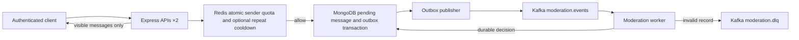

# FrensChat distributed reliability evidence

The local two-replica demo tests shared rate enforcement, safe degradation during dependency outages, and replay-safe moderation. The default app continues using its existing REST and Socket.IO flow. The Kafka moderation demo is opt-in and approved messages appear on refresh.

## Architecture and trade-offs



- Redis failures stop writes while history stays available. Recipient-independent quotas stop sends to a new recipient from resetting the sender's allowance.
- The outbox preserves queued work while the broker is unavailable. Kafka can replay a record, and the conditional MongoDB update prevents a repeat moderation decision.
- The demo uses one Redis server, one Kafka broker, and one MongoDB replica-set member. The fault tests cover process restarts and temporary dependency outages. Live Socket.IO delivery between API replicas is outside this demo.

## Reproduce

Run from the project root with Docker Compose running and local TCP ports 5101 and 5102 available.

```bash
npm ci
npm --prefix frontend ci
npm run verify
npm --prefix frontend audit --omit=dev
node scripts/day4-benchmark.mjs
node scripts/day4-demo.mjs
```

Both runners use isolated named Compose stacks and stop their services when finished. The demo can also emit a timed asciicast replay with `node scripts/day4-demo.mjs --cast`.

The [recorded 63-second demo](evidence/day4-demo.cast) replays with `asciinema play docs/evidence/day4-demo.cast`. It captures an actual smoke and fault-test run.

## Benchmark method

The three configurations use the same application revision, Docker images, two API replicas, MongoDB replica set, request mix, and host. The run toggles Redis and the moderation write path. Each of three trials per configuration uses fresh authenticated accounts, a 39-byte message text field, 20 normal sends paced 1,100 ms apart, and a separate 50-request burst from one sender, split evenly across the replicas. The repeat rule is disabled for these matched quota trials and verified separately in the demo.

HTTP timings include response parsing. The synchronous paths acknowledge with HTTP 201, and the Kafka path acknowledges durable enqueue with HTTP 202. The runner verifies the exact set of admitted message IDs later returned by recipient history. Kafka burst visibility is measured by polling after the last HTTP response, at 250 ms intervals. This workload measures correctness and observed timing at the specified pace and burst size. It does not exercise maximum throughput or cross-replica Socket.IO delivery.

## Measured results

Three trials per configuration, measured on an arm64 Mac with 11 logical CPUs and 18 GiB of host memory. Application revision `36ca072`, API Node 22.23.5, MongoDB 8.0.38, Redis 8.4.8, Kafka 4.1.1. See the [raw trial output](evidence/day4-benchmarks.json) for individual latency percentiles and burst durations.

| Measure | Baseline | Redis | Redis + Kafka |
|---|---:|---:|---:|
| Normal sends accepted and visible | 60/60 | 60/60 | 60/60 |
| Median trial HTTP p95 | 31.53 ms | 31.05 ms | 26.71 ms |
| Observed HTTP p95 range | 28.62–52.38 ms | 30.23–39.76 ms | 21.75–32.06 ms |
| Burst requests accepted and visible | 150/150 | 30/150 | 30/150 |
| Burst requests rejected with HTTP 429 | 0 | 120 | 120 |
| Writes above the 10-send quota | 120 | 0 | 0 |
| Time from final burst HTTP response to all admitted messages observed in history | — | — | 260–515 ms |

The normal workload completed about 0.93–0.95 successful requests per second because the client deliberately paced its sends. Local variation and different HTTP acknowledgement semantics limit direct latency comparisons.

A separate [end-to-end latency benchmark](realtime-latency.md) measures WebSocket delivery and read receipts on the same API replica.

## Fault and smoke checks

- The two-user smoke passed against the upgraded Redis stack. The cooldown then blocked 8 of 8 post-threshold repeats, admitted 5 of 5 distinct sends, and allowed sends again after the cooldown.
- Kafka downtime left one durable unpublished outbox row. A forced crash after the durable decision replayed the same partition and offset in 7.75 seconds after restart, with zero duplicate decisions. One malformed record reached the dead-letter topic and the next valid event completed. No premature Socket.IO events were observed.
- The full local quality gate passed with 13 regression tests, frontend lint and build, and zero reported vulnerabilities in both production npm audits. The workflow runs the Redis and Kafka acceptance tests as a separate job.

## Resume bullets

- **Prevented 120 above-quota message writes across two Express API replicas** with atomic Redis rate limiting, enforcing a 10-send cap in each of three 50-request burst trials.
- **Built a replay-safe Kafka moderation pipeline with a MongoDB transactional outbox**, preserving queued work through a broker outage and recording **zero duplicate decisions** when the same event was replayed after a forced worker crash.
